# STAT4365FinalProj

## Initial Plan

### Objective:
* Predicting medical costs using multiple regression analysis
* Show impact of lifestyle choices on medical expenses
* Compare expected medical expenses across the span of our data

### Area of Interest: 

With healthcare costs continuing to rise, it is vital to understand how lifestyle choices can inform an individual's medical expenditure. By identifying the variables which influence medical expenses, we can help individuals make informed lifestyle decisions that can help save them money and maintain their health. 

### Data: 

* Publicly available dataset from Kaggle
* Response variable: Total charges from health insurance
* Predictor variables: age, sex, bmi, number of children on policy, smoker status, and region

### Exploratory Data Analysis:

* We had no missing data to correct, however if we did we could have done a variety of strategies to correct for this. These methods include: imputation, dropping rows, or dropping columns.

* Plot medical charges against each predictor variable and see what kinds of relationships we can find.
  
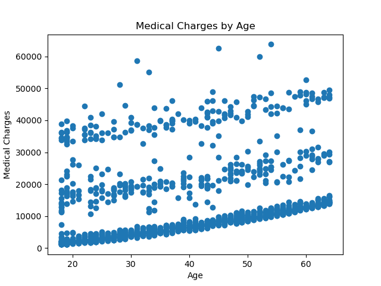

* There are bands of positive linear relationships
  

* Here we see a weak positive linear relationship
  

* Approximately 75% of smokers have higher medical costs than any non-smoker.
* Appears to be strongest relationship
  
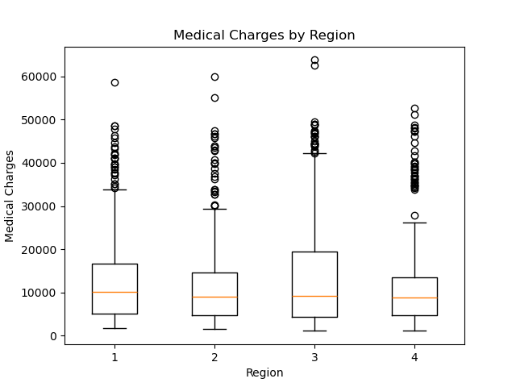

* Here we see minimal deviation between each region
  
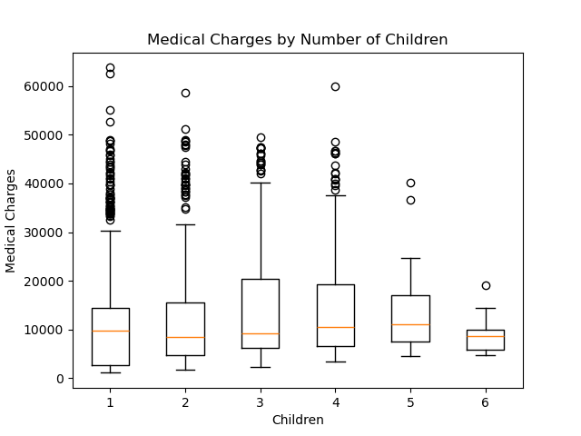

* Surprisingly, there does not appear to be much difference between the number of children and medical costs.

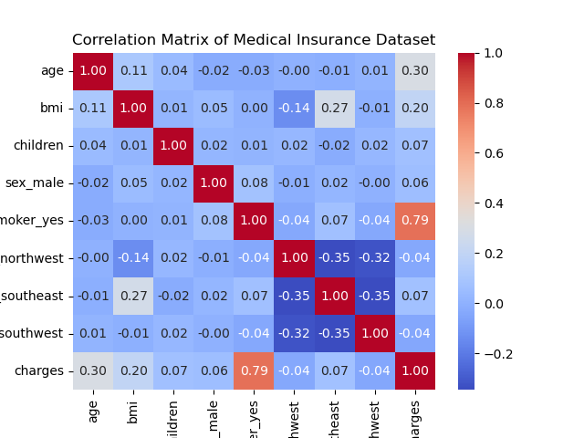

* Our correlation matrix confirms smoking to be strongly correlated to medical prices
* Shows that other variables have weak positive relationships where expected with age and BMI.
* We see there are minimal features with correlation, so multicolinearity should not be an issue (except in cases with dummy variables where perfect colinearity could form)

### Methods: 

* Dummy variables: Smoker, Region
* Train/Test split: 25/75
* Data cleaning
* Multiple Regression

### Global Model:

* This is our model which we will perform backwards selection on.
* Hypotheses:

  $H_0$: All of $\beta_1, \beta_2, ... \beta_n = 0$
  $H_a$: At least one of $\beta_1, \beta_2, ... \beta_n \neq 0$

### Backwards Selection Process:

* Examine model summary of previous model
* Identify highest P-Value, and eliminate this variable (and others associated with it) from the next model
* Refit model and continue process until all P-Values are below .05

### Examining Assumptions:

* The first assumption we examine is the residual plot seen here:

* Violations: Constant Variance, Centered at 0
* Next Steps: Log transformation
* Log model may help with addressing patterns in residual, but would lose interpretability

### Log Transformed Model:

* This fails the same assumptions from earlier still
* Next we attempt to add interaction terms

### Interaction Terms:

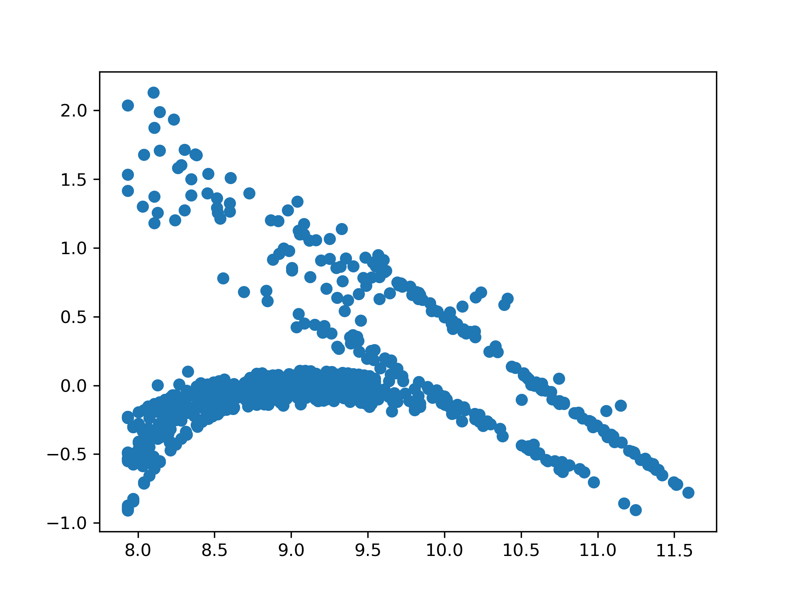

* Here we can see the same violations to our residual plot, so we next attempt weighted regression.

### Weighted Regression Model:

* Weighted Regression advantages and justification:
  1) Medical data can be heavily skewed by a small number of high high variance expenses
  2) Want to focus on a typical individual's expenses
  3) Adjusts heteroscedasticity in residual plot

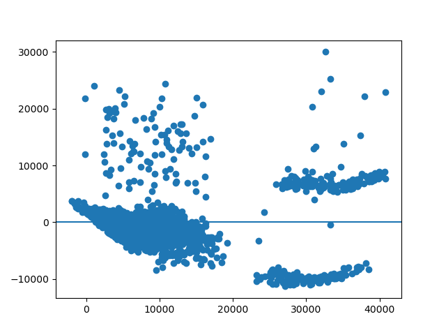

* After viewing this, we can see that our model still fails with certain assumptions
* We next, split the data into smoker and non-smoker categories

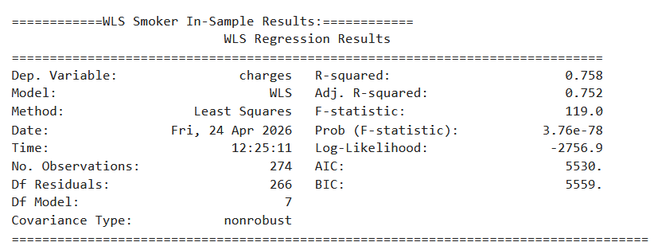

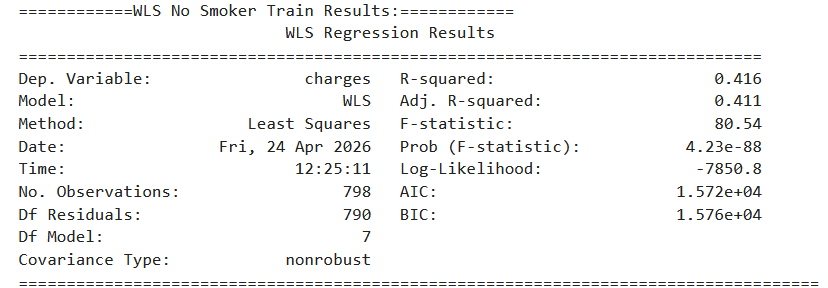

Weighted Regression Resisduals for Smokers

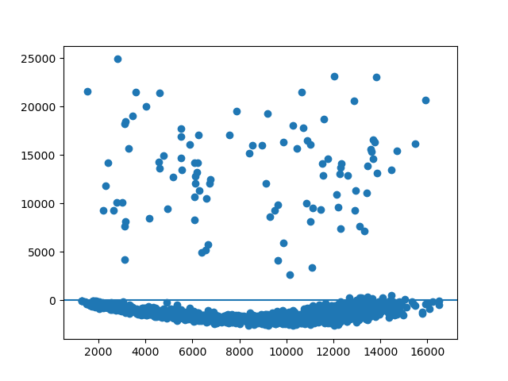

Weighted Regression Residuals for Non-Smokers

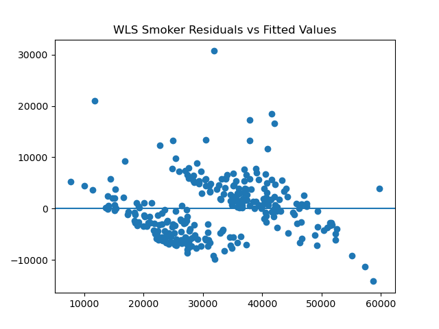

Weighted Regression QQ Plot for Smokers

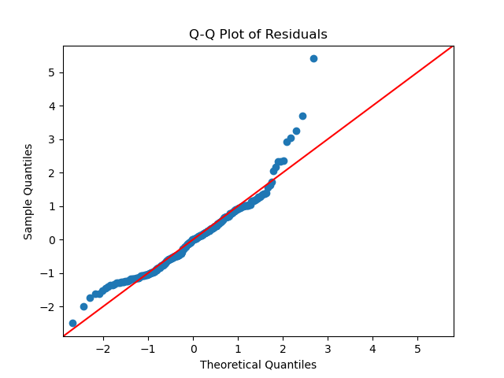

Weighted Regression QQ Plot for Non-Smokers

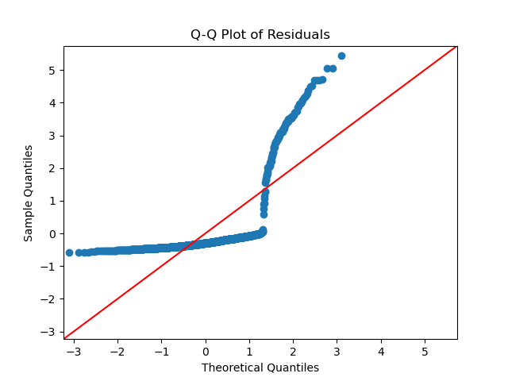

* After viewing this, we can see that our model performs better with assumptions, but it drastically reduces our $R^2$
* $R^2$ drops due to losing key explanatory variable, smoking status, with highest value in correlational matrix
* This shows smoking status is a vital variable in medical costs for individual
* Smokers have consistently higher medical expenses compared to non-smokers with non-smokers having some individuals with high medical prices skewing our data right

## Final Results

Throughout our time working with our dataset revolving around health insurance, we undertook various methods of testing and modeling to help find which variables could best help predict charges for health insurance. This involved using the various tools described previously in the methods section of the intiial plan, alongside new tools like weighted regression and various plots detailing the relationship between certain variables and resulting health insurance charges.

We were unable to explain a high amount of the variance in medical costs while maintaining the assumptions for multiple regression analysis. Despite this setback, we were able to show that smoking increases expected prices for medical charges.

We were able to find evidence that evidence at our significance level of .05 that at least one of our predictor variables in our final model is useful in predicting medical expenses for individuals. We have also shown that holding other variables (and each other at a time) both age and BMI increase, medical expenses increase as our 95% confidence intervals for both variables do not include 0 and are entirely positive. 
