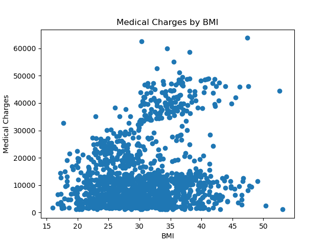
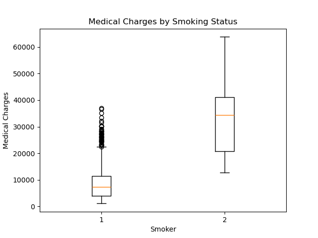
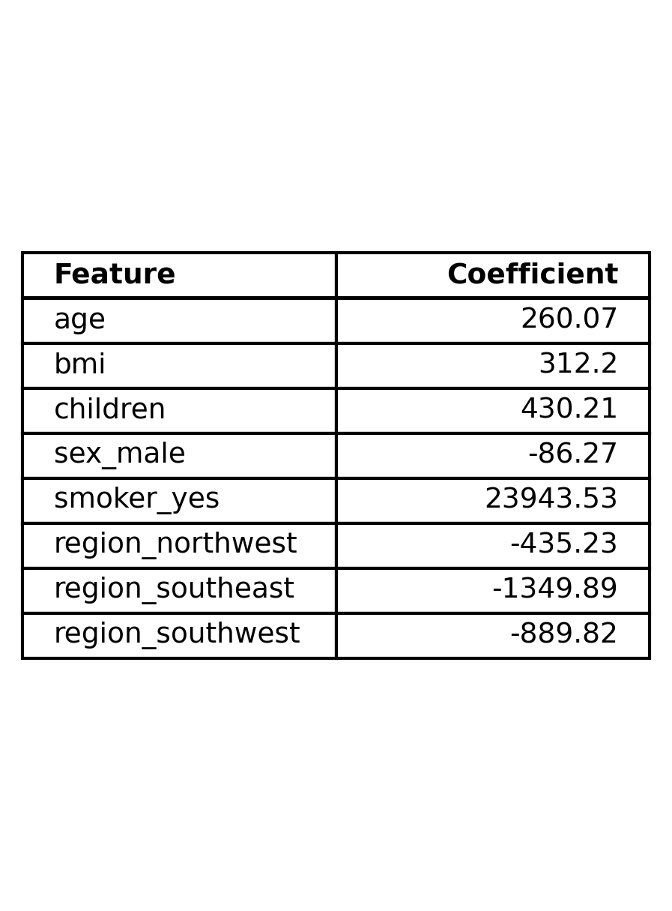
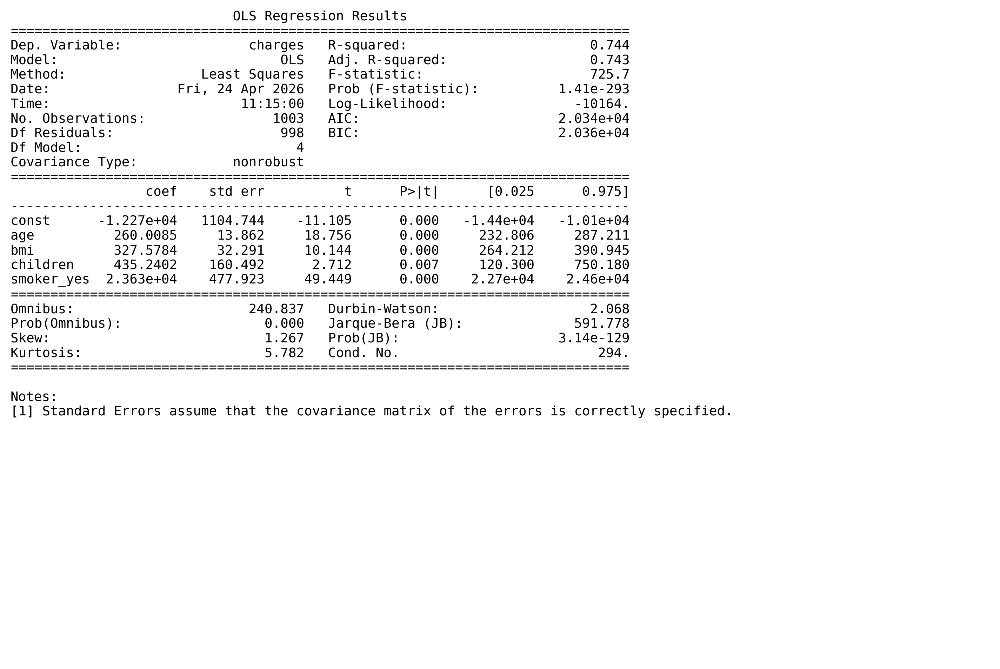
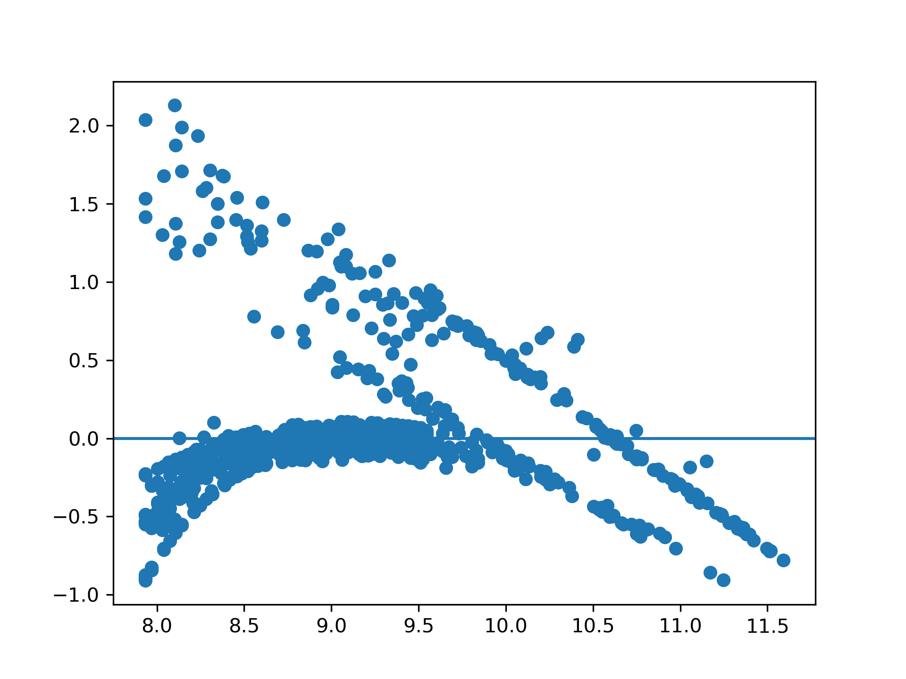
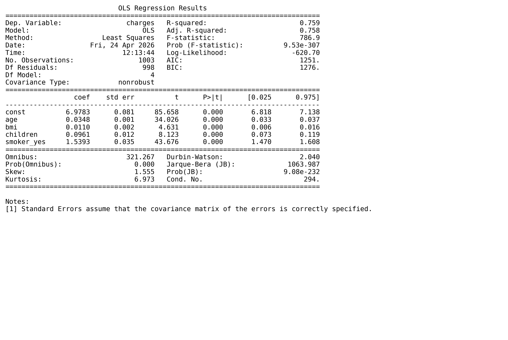
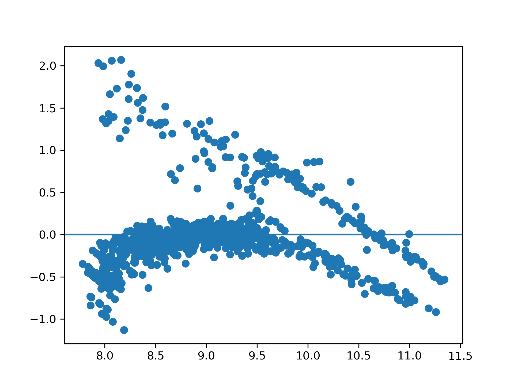

# STAT4365FinalProj

## Initial Plan

### Objective:
* Predicting medical costs using multiple regression analysis
* Show impact of lifestyle choices on medical expenses
* Compare expected medical expenses across the span of our data

### Area of Interest: 
Health insurance plays a vital role in an individual’s ability to afford medical care, but can also represent a major personal expense depending on how at risk an insured is of having health issues. We hope to use this data to find what aspect of a person’s life plays the largest role in having to pay higher expenses.

### Data: 
* Publicly available dataset from Kaggle
* Response variable: Total charges from health insurance
* Predictor variables: age, sex, bmi, number of children on policy, smoker status, and region

### Exploratory Data Analysis:

* Plot medical charges against each predictor variable and see what kinds of relationships we can find.
  

* There are bands of positive linear relationships
  

* Here we see a weak positive linear relationship
  

* Approximately 75% of smokers have higher medical costs than any non-smoker.
* Appears to be strongest relationship
  

* Here we see minimal deviation between each region
  

* Surprisingly, there does not appear to be much difference between the number of children and medical costs.

* Our correlation matrix confirms smoking to be strongly correlated to medical prices
* Shows that other variables have weak positive relationships where expected with age and BMI.

### Methods: 

* Dummy variables: Smoker, Region
* Train/Test split: 25/75
* Data cleaning
* Multiple Regression

### Global Model:

* This is our model which we will perform backwards selection on.
* Hypotheses:

  $H_0$: All of $\beta_1, \beta_2, ... \beta_n = 0$
  $H_a$: At least one of $\beta_1, \beta_2, ... \beta_n \neq 0$

### Backwards Selection Process:

* Examine model summary of previous model
* Identify highest P-Value, and eliminate this variable (and others associated with it) from the next model
* Refit model and continue process until all P-Values are below .05

### Examining Assumptions:

* The first assumption we examine is the residual plot seen here:

* Violations: Constant Variance, Centered at 0
* Next Steps: Log transformation

### Log Transformed Model:

* This fails the same assumptions from earlier still
* Next we attempt to add interaction terms

### Interaction Terms:

* Here we can see the same violations to our residual plot, so we next attempt weighted regression.

### Weighted Regression Model:

* Weighted Regression advantages and justification:
  1) Medical data can be heavily skewed by a small number of high high variance expenses
  2) Want to focus on a typical individual's expenses
  3) Adjusts heteroscedasticity in residual plot

### Expectations: 

* Create a model which can explain a high amount of the variance in medical charges
* Isolate which factors are most important in medical costs
* Analyzing how both categorical and numerical variables impact medical charges

## Final Results

Throughout our time working with our dataset revolving around health insurance, we undertook various methods of testing and modeling to help find which variables could best help predict charges for health insurance. This involved using the various tools described previously in the methods section of the intiial plan, alongside new tools like weighted regression and various plots detailing the relationship between certain variables and resulting health insurance charges.
